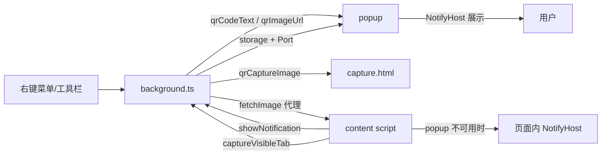

# AGENTS.md

给 AI Agent 与协作者的项目认知。修改代码前先读本文件；用户可见的说明以 [README.md](./README.md) 为准。

## 一句话概述

基于 **WXT + Vue 3 + TypeScript** 的跨浏览器（Chrome / Edge / Firefox）二维码扩展：生成二维码（当前页 / 选中文本）、识别二维码与一维条形码（网页图片 / 截图 / 本地图片 / 剪贴板），并附带简易截图工具。

- 版本号在 [package.json](./package.json)（发布时同步 `version`）
- 无自动化测试；唯一的静态校验是 `pnpm compile`（`vue-tsc --noEmit`）

## 常用命令

```bash
pnpm install          # 安装依赖，postinstall 会执行 wxt prepare
pnpm dev              # 同时调试 Chrome/Edge/Firefox，没装的浏览器静默跳过
pnpm dev:chrome       # 只调试 Chrome，没装则报错退出
pnpm dev:edge         # 只调试 Edge，没装则报错退出
pnpm dev:firefox      # 只调试 Firefox（MV3），没装则报错退出
pnpm compile          # 类型检查（提交前必须通过）
pnpm build            # 打包 Chrome/Edge zip
pnpm build:firefox    # 打包 Firefox zip（含 sources zip）
pnpm submit:chrome|edge|firefox|all   # 构建并提交商店，读取 .env.submit
```

调试时的浏览器 profile 与自动打开的测试页配置在 [wxt.config.ts](./wxt.config.ts)，profile 按浏览器隔离（`.wxt/dev-profile/<browser>`），由 [.dev/dev.mjs](./.dev/dev.mjs) 通过 `WXT_DEV_*` 环境变量注入。

`pnpm dev` 会并行启动多个 `wxt` 实例（dev server 端口 3000/3001/3002，日志带 `[chrome]` 前缀），没装的浏览器直接跳过；`pnpm dev:<browser>` 是严格模式，缺浏览器时直接退出。可执行文件路径可用 `CHROME_BINARY` / `EDGE_BINARY` / `FIREFOX_BINARY` 覆盖。

多进程时子进程没有 TTY，wxt 自带的 `o + enter` 不会生效，所以由 [.dev/dev.mjs](./.dev/dev.mjs) 在父进程里监听，按下后会重启所有已启动的浏览器。

Chromium 系浏览器启动后，[.dev/pin-dev-extension.mjs](./.dev/pin-dev-extension.mjs) 会连调试端口（Chrome 9222、Edge 9223），在 `chrome://extensions` 上下文里调 `chrome.developerPrivate` 把 dev 扩展固定到工具栏，省掉每次手动固定；Firefox 无对应能力。

## 目录导航

| 路径 | 职责 |
| --- | --- |
| [src/entrypoints/background.ts](./src/entrypoints/background.ts) | 后台脚本：右键菜单、popup 打开、通知中转、跨域取图、截图、标签页关闭、地址栏图标开关 |
| [src/entrypoints/content/](./src/entrypoints/content/) | 注入所有页面的内容脚本 UI，处理 `decodeQR` / `screenshotQR` / `screenshotQRDirect` 消息，页面内通知兜底 |
| [src/entrypoints/popup/](./src/entrypoints/popup/) | 工具栏弹窗：生成二维码、展示通知、识别交给它的图片（`scan.html` 交接） |
| [src/entrypoints/scan/](./src/entrypoints/scan/) | 独立识别页 `scan.html`：整页居中布局 + `ImageScanPanel`；仅在页面无法注入内容脚本时作为兜底 |
| [src/entrypoints/capture/](./src/entrypoints/capture/) | 独立截图识别页 `capture.html`：读取后台截取的视口图并框选识别（PDF 等无法注入内容脚本时的兜底）；带 `?direct=1` 时直接识别整图 |
| [src/components/ScreenshotOverlay.vue](./src/components/ScreenshotOverlay.vue) | 本地重写的框选截图组件（拖拽选区、复制、保存） |
| [src/components/ScanOverlay.vue](./src/components/ScanOverlay.vue) | 扫描动画（整屏 / 图片区域两种形态，纯展示不拦截交互） |
| [src/components/ImageScanPanel.vue](./src/components/ImageScanPanel.vue) | 图片识别面板：标题 + `ImagePicker` + 识别流程，`variant` 决定自带遮罩（浮层）还是原地渲染（独立页），与 `ScreenshotOverlay` 的两种宿主同构 |
| [src/components/ImagePicker.vue](./src/components/ImagePicker.vue) | 取图区（粘贴/拖放/选择文件），供面板复用 |
| [src/composables/useImagePasteOverlay.ts](./src/composables/useImagePasteOverlay.ts) | 浮层宿主：`createApp(ImageScanPanel, { variant: 'overlay' })` 挂载/卸载 |
| [src/composables/useScanAnimation.ts](./src/composables/useScanAnimation.ts) | 扫描动画挂载与淡出，`play()` 在扫过量并淡出后才 resolve，用于延后弹窗 |
| [src/services/decodeResultNotice.ts](./src/services/decodeResultNotice.ts) | 识别过程的加载/错误提示与结果通知（无结果/多码/单码）构造 |
| [src/composables/useNoticeFallback.ts](./src/composables/useNoticeFallback.ts) | 通知统一策略：popup 优先、页面内兜底 |
| [src/services/recognize.ts](./src/services/recognize.ts) | **拿到图像数据后的唯一识别入口** `recognizeImage(loader, options)`：动画 → 提示 → 解码 → 结果/重试/错误；网页图片、本地/粘贴图片、截图共用 |
| [src/composables/useImageScan.ts](./src/composables/useImageScan.ts) | 取图面板状态（预览/清空），识别交给 `recognizeImage` |
| [src/services/messaging.ts](./src/services/messaging.ts) | 消息发送封装（统一 lastError 与 success 判断） |
| [src/services/i18n.ts](./src/services/i18n.ts) | `t()` 文案读取（缺失时回退） |
| [src/services/storage.ts](./src/services/storage.ts) | 存储区选择、`takeStoredValue/String` 读后即清 |
| [src/components/NotifyHost.vue](./src/components/NotifyHost.vue) | 本地重写的通知 UI（替代 SweetAlert2），只消费 `useNotify` 状态 |
| [src/composables/useNotify.ts](./src/composables/useNotify.ts) | 全局单例通知状态与 `fire/close/showLoading` API |
| [src/composables/usePopupNoticeHost.ts](./src/composables/usePopupNoticeHost.ts) | popup 侧：读取/接收通知并代内容脚本执行打开、复制、截图 |
| [src/composables/useScreenshot.ts](./src/composables/useScreenshot.ts) | 内容脚本侧的截图流程封装 |
| [src/services/qrScanner.ts](./src/services/qrScanner.ts) | 识别核心：ZXing 深路径导入、条码优先、多码识别、SVG/彩色/倾斜/低对比度候选图 |
| [src/services/popupNotice.ts](./src/services/popupNotice.ts) | 跨进程通知协议（可序列化 payload + `showPopupNotice`） |
| [src/services/clipboard.ts](./src/services/clipboard.ts) | 复制文本（Clipboard API，失败回退 execCommand） |
| [src/services/clipboardImage.ts](./src/services/clipboardImage.ts) | 从 DataTransfer（paste/拖放事件）取图片、Blob→DataURL |
| [src/services/linkText.ts](./src/services/linkText.ts) | 判断识别结果是否为链接、补协议 |
| [src/services/menuIcons.ts](./src/services/menuIcons.ts) | Firefox 右键菜单内联 SVG 图标（跟随主题色） |
| [public/_locales/](./public/_locales/) | `en` 与 `zh_CN` 文案，key 必须成对维护 |
| [.dev/submit.mjs](./.dev/submit.mjs) | 清旧包 → 构建 → 调 `wxt submit` |
| [.dev/dev.mjs](./.dev/dev.mjs) | `pnpm dev` 入口：并行启动多个浏览器 + 后台固定工具栏图标 |
| [.dev/pin-dev-extension.mjs](./.dev/pin-dev-extension.mjs) | 通过调试端口（9222/9223）调 `chrome.developerPrivate` 固定 dev 扩展图标 |

`@/` 别名指向 `src/`（WXT 自动生成，见 `.wxt/tsconfig.json`）。`.wxt/`、`.output/`、`node_modules/` 都是产物目录，不要手改。

## 运行时架构



几个必须理解的设计：

1. **特殊页面优先就地处理**。SVG 文档直接解码页面地址；无法注入内容脚本的 PDF 阅读器页，一键截屏识别把视口截图写入 `qrImageUrl` 交给 popup 就地识别；本地/剪贴板图片识别同样先在当前页挂载 `ImageScanPanel`（overlay 变体），内容脚本不可用时才开 `scan.html`，需要交互框选时才开 `capture.html`。三个入口的降级分发统一由 `tryContentAction` / `resolveActiveTabId` / `sendImageToPopup` / `openExtensionPage` 完成。
2. **通知统一走 popup**。内容脚本调 `showPopupNotice()` → 后台写入 `qrNotification` 存储并通过 `popup` 长连接推送；popup 未打开时后台用 `browser.action.openPopup()`（Firefox 优先 `action`，`pageAction` 仅兜底）。失败返回 `false`，调用方回退到页面内 `NotifyHost`。
3. **通知参数必须可序列化**。`PopupNoticeOptions` 里只有 `loading` 标记，没有回调函数；动作通过 `PopupNoticeAction`（`open` / `copy` / `screenshot`）描述，由 popup 执行。不要为“主动收起通知”单独加消息：popup 窗口被保留而通知已结束时会出现空白窗口；正确做法是用下一条通知（如 `decodingQR`）替换旧通知。popup 里 `notifyState.open` 由 true 变 false 且没有任何内容时会自行关闭窗口。
4. **识别在需要 DOM 的地方完成**。SVG 文档、Firefox 内置 PDF 阅读器等无法注入内容脚本的页面，由 popup / capture 页接管。
5. **后台负责高权限操作**：`tabs.captureVisibleTab`、`fetch` 跨域图片（返回 DataURL）、`tabs.remove`。
6. **弹窗易失焦**：本地文件选择会让 popup 关闭，因此 `scan.html` 与 `capture.html` 都在自己页面里取图，识别结果仍走 `useNoticeFallback`（popup 优先、页面内兜底）。识别流程结束后**不要自动关闭** popup / scan / capture 页面，窗口一律由用户自行关闭；唯一例外是 popup 里"尝试截图识别"需要让出焦点给页面框选。

## 存储键（改动时需全局搜索）

| 键 | 位置 | 说明 |
| --- | --- | --- |
| `qrCodeText` | session（回退 local） | 待生成二维码的文本 |
| `qrImageUrl` | session（回退 local） | 待识别图片的 DataURL / 图片地址 |
| `qrNotification` | session（回退 local） | popup 待展示的最新通知（含自增 `id` 去重） |
| `qrCaptureImage` | session（回退 local） | 后台截取的视口图，读取后立即删除 |
| `pageActionVisible` | local | Firefox 地址栏图标开关，默认显示 |

统一写法：`const storageArea = () => browser.storage.session ?? browser.storage.local;`

## 修改指引

- **新增/调整右键菜单**：改 `background.ts` 的 `addContextMenus` + 点击分支，文案加到两个 locale（Chrome 用 emoji 前缀，Firefox 用 `menuIcons`）。
- **识别效果**：只改 [qrScanner.ts](./src/services/qrScanner.ts)。注意其 ZXing 内部模块深路径导入方式（`@zxing/library/esm/core/...`），不要改成包根导入，避免打进无关代码。
- **通知外观/交互**：`NotifyHost.vue` + `useNotify.ts`；跨进程字段同步改 `popupNotice.ts` 与 `usePopupNoticeHost.ts`。
- **新增 UI 文案**：`public/_locales/en/messages.json` 与 `zh_CN/messages.json` 同时添加，代码中统一用 `browser.i18n.getMessage(key)`（各入口有本地 `t()` 包装）。
- **权限 / manifest / 图标**：只改 [wxt.config.ts](./wxt.config.ts)。不要为此声明 `clipboardRead` / `clipboardWrite`：图片只从 paste/拖放事件读取，文本复制发生在点击手势里，失败时用 `execCommand('copy')` 兜底。
- **截图能力**：视图层在 `ScreenshotOverlay.vue`，流程在 `useScreenshot.ts`。

## 编码约定

- 注释、提交信息、面向用户的说明用**中文**；标识符用英文。
- 缩进 4 空格（Vue `<template>` 内也保持 4 空格）；字符串引号与分号跟随所在文件既有风格（新文件统一单引号 + 分号）。
- 优先复用现有 service/composable，不要为单个页面另写一套通知、复制、识图逻辑。
- 不引入新依赖，除非确实缺失能力；重量级库已有 `@zxing/library`、`qrcode-generator`、`vue`。
- 改动要保持 Chrome / Edge / Firefox 行为一致；平台差异用 `import.meta.env.FIREFOX` 分支。
- 不要提交 `.env.submit`（商店凭据），也不要改 `.env` 里的本机路径。
- 仓库暂未提交 lockfile；安装依赖后不要顺手提交新生成的 `pnpm-lock.yaml`，除非用户明确要求。
- `pnpm-workspace.yaml` 通过 `patchedDependencies` 打补丁（`.dev/web-ext.patch` 去掉会自动添加 `navigator.webdriver` 的启动参数）；升级 `web-ext` 后需确认补丁仍能应用。

## 已知坑

- **Firefox popup**：截图完成等异步流程里 `pageAction.openPopup()` 会因缺少用户手势被拒，必须优先 `action.openPopup()`。
- **`captureVisibleTab` 必须在后台调用**，否则会触发屏幕共享提示并压缩视口。
- **大图识别会阻塞 UI**：先渲染 loading 通知，再 `await new Promise(r => setTimeout(r, 50))` 后开始解码。
- **跨域/防盗链图片**：直接 fetch 常失败，已有"新标签打开图片"和"改用截图识别"两个出口，改动时保留兜底。
- **`file://` 页面**：Firefox 扩展页/后台无法 fetch，但内容脚本可读已渲染图片并画到 canvas；失败再回退到截取视口。
- **通知竞态**：后台在 `openPopup` 期间用 `popupOpening` / `POPUP_OPEN_GRACE` 防丢通知，并靠自增 `id` 做 `clearNoticeIfCurrent`，不要简化掉。
- **旧通知清理**：popup 断开连接时后台会删 `qrNotification`，避免下次打开重复弹出。
- **开发时固定图标**：未打包扩展的 pin 只存在内存里，写 `.wxt/dev-profile/.../Preferences` 的 `extensions.pinned_extensions` 无效（Chrome 会忽略），只能由 `.dev/pin-dev-extension.mjs` 在运行时调 `chrome.developerPrivate.updateExtensionConfiguration`。Chrome 与 Edge 同时调试时要各用一个调试端口（9222/9223），否则第二个浏览器连不上。改这段前先用 CDP 实测，别按经验猜。

## 完成标准

1. `pnpm compile` 通过。
2. 涉及 UI/交互/识别的改动，用 `pnpm dev`（或 `dev:firefox`）实际验证至少一条主链路：生成二维码、图片识别、截图识别、本地/剪贴板识别、通知按钮。
3. 新增文案在 `en` / `zh_CN` 两个 locale 中都存在。
4. 不夹带无关修改；提交信息简洁说明用户可见变化。
