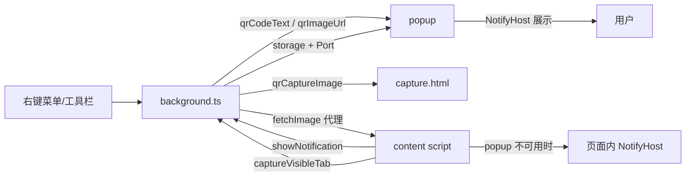

# AGENTS.md

给 AI Agent 与协作者的项目认知。改代码前先读本文件；用户可见说明见 [README.md](./README.md)。

## 概述

**WXT + Vue 3 + TypeScript** 跨浏览器（Chrome / Edge / Firefox）二维码扩展：生成二维码（当前页 / 选中文本），扫描二维码与一维条形码（网页图片 / 截图 / 本地图片 / 剪贴板），附带简易截图工具。

- 版本号在 [package.json](./package.json)，发布时同步 `version`。
- 无自动化测试，唯一静态校验是 `pnpm compile`（`vue-tsc --noEmit`）。

## 常用命令

```bash
pnpm install       # postinstall 会执行 wxt prepare
pnpm dev           # 只调试 Chrome：wxt -b chrome -p 3001，并自动固定 dev 图标
pnpm dev:firefox   # 只调试桌面 Firefox：wxt -b firefox --mv3（端口 3000）
pnpm dev:android   # Firefox for Android：wxt 只出 dev 版，web-ext 经 adb 装到手机，dev server 端口走 adb reverse 供热更新
pnpm wxt -b edge -p 3002  # Edge 没有专用脚本，需要时手敲（不带 -p 会撞 Firefox 的 3000）
pnpm compile       # 类型检查，提交前必须通过
pnpm build         # 打包 Chrome/Edge zip
pnpm build:firefox # 打包 Firefox zip（含 sources）
pnpm submit:chrome|edge|firefox|all  # 构建并提交商店；wxt 自读 .env.submit（不要先 source：PEM 私钥是单行 \n）
```

- profile 按浏览器隔离于 `.wxt/dev-profile/<browser>`；[wxt.config.ts](./wxt.config.ts) 从 `-b` 参数推导浏览器，据此选 profile 与调试端口，测试页也在那里配置。
- 端口固定（Chrome 3001 / Firefox 3000，Edge 手敲时用 3002），可执行文件用 `CHROME_BINARY` / `EDGE_BINARY` / `FIREFOX_BINARY` 覆盖（脚本不探测浏览器路径，缺浏览器由 wxt 报错）；`dev.server.strictPort` 开启，被占即报错（换端口会断热更新，两个实例还会争写 `.output`）。先结束旧进程再重启。
- `pnpm dev` 把 stdio 直接交给 wxt，wxt 自带的 `o` 键重启照常可用；`pnpm dev:android` 没有 TTY，日志按 `[wxt]` / `[android]` 前缀转发。
- `pnpm dev` 启动后 [.dev/pin-dev-extension.mjs](./.dev/pin-dev-extension.mjs) 连调试端口（Chrome 9222），在 `chrome://extensions` 上下文调 `chrome.developerPrivate` 固定 dev 图标；Firefox 无此能力。`pnpm dev:firefox` 与手敲的 Edge 不跑这层，需要时在 `chrome://extensions` 手动固定。
- 手机调试只支持 Firefox for Android（Chromium 系手机浏览器基本不支持扩展）：手机开 USB 调试并授权后跑 `pnpm dev:android`，脚本自动找 adb（`ADB_BIN` 可覆盖，默认按 `ANDROID_HOME` / `ANDROID_SDK_ROOT` / `~/Android/Sdk` 探测），`ANDROID_DEVICE` 指定多设备里的哪台，`FIREFOX_APK` 换 Nightly 等包名。桌面 Firefox 不会被拉起，装包与设备连接由 [.dev/android.mjs](./.dev/android.mjs) 负责（重装重跑命令，外壳脚本不再接管 `o` 键）；热更新复用 WXT dev server（端口 3000 经 `adb reverse` 打通），所以 web-ext 那边关了自带的 reload。
- 无线调试同一套流程：Android 11+ 在开发者选项里开「无线调试」→ `adb pair <ip>:<配对端口>` 输配对码 → `adb connect <ip>:<调试端口>`，`adb devices` 出现 `ip:port` 后脚本下一轮轮询就会自动安装（换设备时 `ANDROID_DEVICE=<ip>:port`）。`adb reverse` 走 adb 隧道，无线下热更新同样有效。

## 目录导航

| 路径 | 职责 |
| --- | --- |
| [src/entrypoints/background.ts](./src/entrypoints/background.ts) | 后台：右键菜单、打开 popup、通知中转、跨域取图、截图、关标签页、图标开关 |
| [src/entrypoints/content/](./src/entrypoints/content/) | 全站注入 UI；消息 `scanWebImage` / `scanScreen` / `scanLocalImage` / `frameScan`；页面内通知兜底 |
| [src/entrypoints/popup/](./src/entrypoints/popup/) | 工具栏弹窗：生成二维码、展示通知、扫描图片 |
| [src/entrypoints/upload/](./src/entrypoints/upload/) | `upload.html`：`?camera=1` 以摄像头模式开 `ScanPanel`；内容脚本注入不了时的兜底页 |
| [src/entrypoints/capture/](./src/entrypoints/capture/) | `capture.html`：截视口后直出扫描（PDF、SVG 等注入不了内容脚本的页面兜底） |
| [src/components/ScreenshotOverlay.vue](./src/components/ScreenshotOverlay.vue) | 截图容器：承载整屏扫描结果（冻结截图 + 蓝框蓝点），结果画面上仍可拖框另选一块重扫，选区可复制/保存 |
| [src/components/ScanOverlay.vue](./src/components/ScanOverlay.vue) | 扫描动画（整屏 / 图片区域，不拦截交互）；图片区域按 [overlayHost.ts](./src/services/overlayHost.ts) 挂进图片所在容器并排在图片之后，只压住图片而不越过后加入的页面浮层 |
| [src/components/ScanMarks.vue](./src/components/ScanMarks.vue) | 命中后在码上标蓝框与可点蓝点；网页图片传 `anchor` 跟随图片所在层（同 [overlayHost.ts](./src/services/overlayHost.ts)），截图容器里则铺在其结果层内 |
| [src/services/overlayHost.ts](./src/services/overlayHost.ts) | 扫码叠加层（扫描动画、命中蓝框）的挂载策略：优先挂进图片容器只压住图片；祖先改掉 `fixed` 参照时退回 `body` 保持最高层 |
| [src/components/QrCodePanel.vue](./src/components/QrCodePanel.vue) | 二维码生成面板（预览 + 单输入框 + 展开后的复制/下载与扫码入口） |
| [src/components/ScanPanel.vue](./src/components/ScanPanel.vue) | 唯一扫描面板：图片 / 摄像头两种 `mode` |
| [src/components/ImagePicker.vue](./src/components/ImagePicker.vue) | 取图区（粘贴 / 拖放 / 选文件） |
| [src/composables/useImagePasteOverlay.ts](./src/composables/useImagePasteOverlay.ts) | 浮层宿主：`createApp(ScanPanel, { variant: 'overlay', mode: 'image' })` |
| [src/composables/useScanAnimation.ts](./src/composables/useScanAnimation.ts) | 扫描动画挂载与淡出：`play()` 只等首帧，`stop()` 淡出后 resolve（用于延后弹窗） |
| [src/composables/useCodePicker.ts](./src/composables/useCodePicker.ts) | **各入口共用的多码点选**：`show(results, anchor)` 叠蓝点、`pick` 切结果、空白点击/宽度变化收起 |
| [src/services/imageRect.ts](./src/services/imageRect.ts) | `measureImageRect(img)`：按 `object-fit` 算图片实际绘制区域，点选锚点与扫描动画都靠它 |
| [src/services/decodeResultNotice.ts](./src/services/decodeResultNotice.ts) | 扫描提示与结果通知 |
| [src/composables/useNoticeFallback.ts](./src/composables/useNoticeFallback.ts) | 通知策略：popup 优先、页面内兜底 |
| [src/services/recognize.ts](./src/services/recognize.ts) | **唯一扫描入口** `recognizeImage(loader, options)`，`afterDecode` 会 await 等动画淡出 |
| [src/composables/useQrCode.ts](./src/composables/useQrCode.ts) | 防抖生成二维码，返回 `svg` / `dataUrl`(PNG 预览) / 错误文案 |
| [src/composables/useImageSource.ts](./src/composables/useImageSource.ts) | 图片取图源 |
| [src/composables/useCameraScan.ts](./src/composables/useCameraScan.ts) | 摄像头取图源（逐帧轻量解码） |
| [src/services/messaging.ts](./src/services/messaging.ts) | 消息发送封装（lastError / success） |
| [src/services/i18n.ts](./src/services/i18n.ts) | `t()` 读文案 |
| [src/services/storage.ts](./src/services/storage.ts) | 存储区选择、`takeStoredValue/String` 读后即清 |
| [src/services/screenshotSettings.ts](./src/services/screenshotSettings.ts) | 框选入场动画开关（`storage.local`，默认开） |
| [src/components/NotifyHost.vue](./src/components/NotifyHost.vue) | 通知 UI（替代 SweetAlert2），只消费 `useNotify` |
| [src/composables/useNotify.ts](./src/composables/useNotify.ts) | 全局单例通知状态与 `fire/close/showLoading` |
| [src/composables/usePopupNoticeHost.ts](./src/composables/usePopupNoticeHost.ts) | popup 侧执行打开、复制、截图 |
| [src/composables/useScreenshot.ts](./src/composables/useScreenshot.ts) | 内容脚本侧截图流程；`src` 复用已截好的图，`initialResults` 直接以整张截图作为结果画面 |
| [src/services/qrCode.ts](./src/services/qrCode.ts) | 编码与 SVG 生成（预览 / 复制的 PNG 由同一份 SVG 光栅化） |
| [src/services/qrScanner.ts](./src/services/qrScanner.ts) | 扫描核心（ZXing） |
| [src/services/popupNotice.ts](./src/services/popupNotice.ts) | 跨进程通知协议 |
| [src/services/popupHost.ts](./src/services/popupHost.ts) | 后台侧 popup 宿主：通知落盘/推送、打开窗口、开合竞态兜底 |
| [src/services/clipboard.ts](./src/services/clipboard.ts) | 复制文本 |
| [src/services/clipboardImage.ts](./src/services/clipboardImage.ts) | 从 DataTransfer 取图 |
| [src/services/linkText.ts](./src/services/linkText.ts) | 链接判断与补协议 |
| [src/services/menuIcons.ts](./src/services/menuIcons.ts) | Firefox 菜单内联图标 |
| [public/_locales/](./public/_locales/) | `en` / `zh_CN` 文案，key 成对维护 |
| [.dev/submit.mjs](./.dev/submit.mjs) | 清旧包 → 构建 → `wxt submit` |
| [.dev/dev.mjs](./.dev/dev.mjs) | `pnpm dev` 入口：只调 Chrome，固定端口 + 自动固定 dev 图标 |
| [.dev/android.mjs](./.dev/android.mjs) | `pnpm dev:android` 入口：adb + web-ext 装到手机 |
| [.dev/pin-dev-extension.mjs](./.dev/pin-dev-extension.mjs) | 经调试端口固定 dev 图标 |

`@/` 指向 `src/`（WXT 自动生成，见 `.wxt/tsconfig.json`）。`.wxt/`、`.output/`、`node_modules/` 是产物目录，不要手改。

面板交互约束（别丢）：`QrCodePanel` 在 popup 里 `collapsible` 默认收起，入口是整块二维码热区（点击切换、键盘聚焦可切换且带描边，不再有箭头图标），两态尺寸与留白一致，聚焦即全选（复制走键盘，不再内嵌复制按钮），编辑区用 `grid-template-rows: 0fr → 1fr` 做抽屉式滑出（不要写死高度），展开态在输入框下方依次提供复制 / 下载（PNG 带白底、SVG 透明背景，下载图标 + 格式缩写区分两者）与图片 / 屏幕 / 摄像头扫码入口（复制 / 下载收进抽屉，不再做悬停浮层）；`ScanPanel` 两源共用固定深色 4:3 取景框 + 一行提示 + 一行按钮（换源尺寸不变），标题右侧切源，`variant` 决定自带遮罩（浮层）或原地渲染（独立页）。

## 运行时架构



1. **特殊页面就地处理**：网页 / 本地 / 剪贴板图片走 `scanWebImage`、`scanLocalImage`；直接打开的 SVG 注入不了内容脚本，图片交 popup；扫描屏幕在内容脚本不可用时由后台截视口后开 `capture.html` 直识整图（Firefox 内置 PDF 阅读器同此）。扫描要在需要 DOM 的地方完成，降级分发统一走 `tryContentAction` / `resolveActiveTabId` / `sendImageToPopup` / `openExtensionPage`。
2. **通知统一走 popup**：`showPopupNotice()` → 后台写 `qrNotification` 经 `popup` 长连接推送；popup 未开则优先 `pageAction.openPopup()`，不可用或被拒绝时回退 `action.openPopup()`，失败返回 `false` 时调用方回退页面内 `NotifyHost`。`capture.html` 的 payload 带 `closeOriginTab`，通知结束（`notificationResolved` 或 popup 关闭）时后台按 `originTabId` 关掉来源页。
3. **通知参数必须可序列化**：`PopupNoticeOptions` 只有 `loading`，动作由 `PopupNoticeAction`（`open` / `copy` / `screenScan` / `frameScan`）描述。不要为“收起通知”加消息：通知已结束而 popup 被保留会留空白窗口，用下一条通知（如 `decodingQR`）替换；`notifyState.open` 转 false 且无内容时 popup 自行关闭。
4. **popup 易失焦**：选本地文件会关 popup，故 `upload.html` 与 `capture.html` 各自取图，结果走 `useNoticeFallback`；扫描结束**不自动关闭**（例外：popup 的“改用扫描屏幕”要让出焦点）。`capture.html` 通知结束即关自身：popup 里由后台按 `closeTabId` 关，页面内由 `onLocalNoticeDone` 关（被替换不算结束）。临时页由 `openExtensionPage` 打开（`tabs.create` 带来源页 `windowId` 与 `index + 1` 紧邻原页，并在 `qrExtensionOriginTabs` 登记）：关闭走 `closeTabAndReturn`（先 `tabs.update(来源页, { active: true })` 再 `tabs.remove`），用户点 X 由 `tabs.onRemoved` 同样切回。
5. **后台负责高权限操作**：`tabs.captureVisibleTab`、跨域 `fetch`（返回 DataURL）、`tabs.remove`。

## 存储键（改动时需全局搜索）

| 键 | 位置 | 说明 |
| --- | --- | --- |
| `qrCodeText` | session（回退 local） | 待生成二维码的文本 |
| `qrImageUrl` | session（回退 local） | 待扫描图片的 DataURL / 地址 |
| `qrNotification` | session（回退 local） | popup 待展示的最新通知（含自增 `id` 去重） |
| `qrCaptureImage` | session（回退 local） | 后台截取的视口图，读后即删 |
| `qrExtensionOriginTabs` | session（回退 local） | 临时扩展页 id → 来源标签页 id，关闭前切回、关闭后清除 |
| `pageActionVisible` | local | Firefox 地址栏图标开关，默认显示 |

统一写法：`const storageArea = () => browser.storage.session ?? browser.storage.local;`

## 修改指引

- **右键菜单**：改 `background.ts` 的 `addContextMenus` + 点击分支，文案加进两个 locale（Chrome 用 emoji 前缀，Firefox 用 `menuIcons`）。
- **二维码生成**：以 [qrCode.ts](./src/services/qrCode.ts) 的 SVG 为唯一来源（只画深色模块、背景透明），预览、复制、PNG 下载都由它 `svgToPngDataUrl()` 光栅化成带白底的位图，SVG 下载直接给源文件，别再另写一套 canvas 绘制；输入/预览在 [QrCodePanel.vue](./src/components/QrCodePanel.vue)；条形码生成未接入。
- **码的位置标记**：`DecodeResult.bounds` 是码在解码所用图像中的像素包围盒：裁剪候选图靠 `Candidate.offsetX/Y` 平移回原图，缩放/旋转过的条形码候选图靠 `BoundsMapper` 换算，其余统一由 `toRect` 夹紧。**换算回原图之后的补高与夹紧一律按原图尺寸算，不能按候选图尺寸**（超过 `BARCODE_SCAN_DIMENSION` 的截图会先被缩小，按候选图高度夹会把原图的 y 压到候选图高度上，条形码标记就塌成一条线并跑到别处）。一维结果的定位点只到扫描行，条高方向就是包围盒的短边，由 `measureBarcodeBounds` 在原图上按条空剖面找连续带、再逐行解码确认，别再退回按宽度比例估算（UPC 条高约等于宽的一半，估算只补了宽度的 8%）。**条空排列方向上定位点在起始/终止图案的中心**（UPC/EAN 是 3 模块定界符中间的空隙、Code 128 是起始符中心），直接当边缘会把最外两根黑条切在框外，由 `measureBarEdges` 沿该方向走到静区取最外黑像素，别改回直接用定位点。调用方用 `DecodeOutcome.imageSize` 与目标矩形换算成 CSS 像素再画框，别在解码层输出页面坐标。命中码时先由 `toMarkRects(results, anchor)` 换算蓝框，`anchor` 只描述"图像画在视口哪块矩形上"（在结果画面里另框一块=选区并带 `clip`、网页图片/面板预览=`measureImageRect(img)` 的实际绘制区域、摄像头预览加 `mirrorX`）；网页图片的锚点要带 `measureRect`，蓝框每次重算都取图片实时位置——只按滚动差量平移的话，固定不随页面滚动的图片（图片查看器、`position: fixed` 浮层）上蓝框会随滚动漂移，`recognizeImage` 传 `deferResults` 暂缓结果通知，再由宿主 `notifyResults(results, { pickHint: 多码 })` 与蓝点同时给出。**扫描屏幕不在页面上叠蓝框**：解码完把这张视口截图交给 `startScreenshot({ src, initialResults })`，由截图容器铺满视口展示结果（`applyImageResults` 按解码图坐标换算到显示区域），标记跟着静止的截图走，页面滚动、内层容器滚动、缩放一概不影响位置；在结果画面上另框一块重扫则改用 `ScreenshotSession.showResults(marks)`，浮层确认时已冻结，蓝框按浮层自身显示区域（不是视口）记录并整体缩放——截图是改窗口大小之前拍的，浮窗按截图比例收缩，与改后的视口宽高比不同，按视口换算再统一缩放会让蓝框纵向差一截；`startScreenshot` 每次确认都回调 `onCapture`，所以同一个浮层能连续框选，没扫到用 `clearResults` 只清蓝框、留住截图。点哪个码就把通知切到哪个码，并撤掉该码的蓝框蓝点（面板与网页图片走 `useCodePicker.pick`，截图容器走 `ScreenshotSession.removeResult(index)`：两边都按同一份结果列表删，别只删渲染出来的框），剩下的继续可点；空白点击由 composable 在 `document` 捕获阶段判断（不铺全屏透明层，面板按钮照常可用），通知窗口刚被这次点击关掉时保留蓝点，只有窗口**宽度**变化会让页面重排时才收起（带 `measureRect` 的锚点不收起，重测一次即可跟住新排版）。
- **扫描效果**：只改 [qrScanner.ts](./src/services/qrScanner.ts)。ZXing 用深路径导入（`@zxing/library/esm/core/...`），别改成包根导入；摄像头逐帧只走 `decodeCameraFrame`，换 `decodeAllFromImageData` 会卡预览；一维码命中后必须过 `isOneDResultConfirmed` 核对相邻行（文字行也能凑出校验位合法的条码，少了这层会把正文认成条形码），批量扫描里未通过的结果只遮罩不中断，否则一处误判会挡住同图真正的条码。二维码整图/码面矩形都没扫出时会把整图缩到 `QR_DOWNSCALE_DIMENSION` 再扫一遍（模块过大时 ZXing 的定位点会漏检），命中坐标靠 `Candidate.scale` 换回原图，这层别删。
- **摄像头扫码**：右键菜单的“摄像头扫码”（`scanCamera`）直接开 `upload.html?camera=1`；面板本体仍只在 `ScanPanel.vue`，不要塞进 popup（失焦即关）。内容脚本也能 `getUserMedia`，但受页面安全上下文与 `Permissions-Policy` 约束、权限归页面源，故浮层失败时降级 `upload.html?camera=1`；媒体流与取帧在 `useCameraScan.ts`，命中即停，用户点“继续扫描”恢复。新增输入方式只实现一个“产出图像”的源，别拆第二套面板/扫描流程。
- **通知外观/交互**：`NotifyHost.vue` + `useNotify.ts`；跨进程字段同步改 `popupNotice.ts` 与 `usePopupNoticeHost.ts`。
- **新增 UI 文案**：`public/_locales/en/messages.json` 与 `zh_CN/messages.json` 同时添加，代码里统一 `browser.i18n.getMessage(key)`（各入口有本地 `t()` 包装）。
- **权限 / manifest / 图标**：只改 [wxt.config.ts](./wxt.config.ts)。不要声明 `clipboardRead` / `clipboardWrite`：图片只从 paste/拖放事件读，文本复制在点击手势里，失败用 `execCommand('copy')` 兜底。
- **截图**：视图层 `ScreenshotOverlay.vue`；普通页面由 `useScreenshot.ts` 就地挂载承载扫描结果（`startScreenshot({ src, initialResults })`，`close` 收起），SVG / PDF 等页面由 [capture/App.vue](./src/entrypoints/capture/App.vue) 接管（后台截视口 → 存储 → 直出扫描）。扫描屏幕（`scanScreen`）先播整屏扫描动画，解码结束再把截图交给这个浮层，不要再改回在页面上叠蓝框；没有独立的框选扫描入口了。

## 编码约定

- 注释、提交信息、面向用户的说明用**中文**，标识符用英文。
- 缩进 4 空格（Vue `<template>` 内同样）；引号与分号跟随所在文件，新文件统一单引号 + 分号。
- 优先复用现有 service / composable，不要为单个页面另写通知、复制、识图逻辑。
- 不引入新依赖；重量级库已有 `@zxing/library`、`qrcode-generator`、`vue`。
- Chrome / Edge / Firefox 行为保持一致，平台差异用 `import.meta.env.FIREFOX` 分支。
- 不提交 `.env.submit`（商店凭据），也不改 `.env` 里的本机路径。
- 仓库暂未提交 lockfile，不要顺手提交新生成的 `pnpm-lock.yaml`，除非用户明确要求。
- `pnpm-workspace.yaml` 用 `patchedDependencies` 给 `web-ext` 打补丁（`.dev/web-ext.patch` 去掉自动加的 `navigator.webdriver` 参数），升级后确认补丁仍能应用。

## 已知坑

- **大图扫描阻塞 UI**：先渲染 loading 通知，再 `await new Promise(r => setTimeout(r, 50))` 后解码。
- **提示分两段，动画在取图之后**：网络取图慢于 150ms 才提示“正在获取图片...”（`notifyFetching`），图就绪后才提示“正在扫描...”并播动画（`beforeNotice`）；本地图 / 截图不需要 `notifyFetching`。
- **跨域 / 防盗链图片**：直接 fetch 常失败，失败提示里保留“改用扫描屏幕”出口；不要再加“跨域可能稍慢”通知，与“正在获取图片...”重复。
- **同源重定向到 CDN**：如 GitHub 的 `/owner/repo/raw/...` 302 到 `raw.githubusercontent.com`，`isSameOrigin` 只看跳转前地址，Chrome 因此判 canvas 被污染。`loadImageDataFromUrl` 捕获污染错误后自动改走后台代理，这层兜底不能删；`fetchViaProxy` 也别改回只在跨域时传。
- **`file://` 页面**：Firefox 扩展页/后台无法 fetch，但内容脚本能读已渲染图片画到 canvas，失败再回退截取视口。
- **通知竞态与清理**：后台 `popupHost`（[popupHost.ts](./src/services/popupHost.ts)）打开窗口期间用 `opening` / `POPUP_OPEN_GRACE` 防丢通知，靠自增 `id` 做 `clearIfCurrent`；popup 断开连接时后台删 `qrNotification`，避免下次重复弹出。都不要简化。
- **页面全局 CSS 会泄漏进注入 UI**：如 `example.com` 的 `svg { margin: -2.75em auto 0; opacity: .55 }` 会把图标顶到按钮外；新增图标时在 `.qr-shot` / `.qr-notify-root` / `.qr-picker-icon` 上声明完整 `margin` 与 `opacity`。
- **独立 SVG/XML 文档不要挂 integrated UI**：直接打开的 `.svg`（如 `https://app.trakt.tv/favicon.svg`）里 `document.createElement('div')` 没有 `.style`，`createIntegratedUi` 会在 `applyPosition` 设 `overflow` 时抛 `Cannot set properties of undefined`。`content/index.ts` 已在 `main()` 开头做能力检查跳过这类文档，扫描交 popup / `capture.html`，不要删。
- **开发时固定图标**：未打包扩展的 pin 只在内存里，写 `.wxt/dev-profile/.../Preferences` 的 `extensions.pinned_extensions` 无效；只能由 `.dev/pin-dev-extension.mjs` 运行时调 `chrome.developerPrivate.updateExtensionConfiguration`。改这段前先用 CDP 实测。
- **开发端口号变化**：开发时使用的端口号变化时，浏览器可能会无法加载最新版本的扩展。需要卸载旧扩展再重新加载。

## 完成标准

1. `pnpm compile` 通过。
2. 新增文案在 `en` / `zh_CN` 两个 locale 中都存在。
3. 不夹带无关修改；提交信息简洁说明用户可见变化。

## 提交标准

每轮对话后都提示用户是否提交更改。

涉及多会话的更改时，优先提交自己对话中的更改，再问用户是否分批次提交其他会话的更改。
