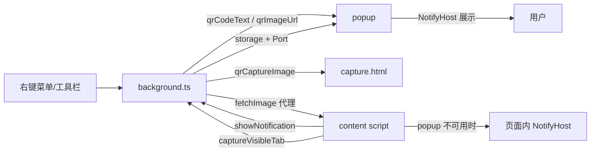

# AGENTS.md

给 AI Agent 与协作者的项目认知。改代码前先读本文件；用户可见说明见 [README.md](./README.md)。

## 概述

**WXT + Vue 3 + TypeScript** 跨浏览器（Chrome / Edge / Firefox）二维码扩展：生成二维码（当前页 / 选中文本），扫描二维码与一维条形码（网页图片 / 截图 / 本地图片 / 剪贴板），附带截图扫描与框选重扫。

版本号在 [package.json](./package.json)，发布时同步 `version`。无自动化测试，唯一静态校验是 `pnpm compile`（`vue-tsc --noEmit`）。

## 常用命令

```bash
pnpm install       # postinstall 会执行 wxt prepare
pnpm dev           # 只调试 Chrome：wxt -b chrome -p 3001，并自动固定 dev 图标
pnpm dev:firefox   # 只调试桌面 Firefox：wxt -b firefox --mv3（端口 3000）
pnpm dev:android   # Firefox for Android：wxt 只出 dev 版，web-ext 经 adb 装到手机，热更新端口走 adb reverse
pnpm wxt -b edge   # Edge 没有专用脚本，需要时手敲（端口由 wxt.config.ts 给：3002）
pnpm compile       # 类型检查，提交前必须通过
pnpm build         # 打包 Chrome/Edge zip
pnpm build:firefox # 打包 Firefox zip（含 sources）
pnpm submit:chrome|edge|firefox|all  # 构建并提交商店；wxt 自读 .env.submit（不要先 source：PEM 私钥是单行 \n）
```

- profile 与端口都由 [wxt.config.ts](./wxt.config.ts) 按 `-b` 推导：profile 在 `.wxt/dev-profile/<browser>`，端口写死在 `DEV_SERVER_PORTS`（Chrome 3001 / Firefox 3000 / Edge 3002），可执行文件用 `CHROME_BINARY` / `EDGE_BINARY` / `FIREFOX_BINARY` 覆盖（不探测路径，缺浏览器由 wxt 报错）。
- 同一浏览器只能开一个 dev 实例：端口被占直接退出；换端口会断热更新，两个实例还会争写 `.output`。先结束旧进程再重启。
- `pnpm dev` 把 stdio 交给 wxt，`o` 键重启照常；启动后 [.dev/pin-dev-extension.mjs](./.dev/pin-dev-extension.mjs) 经调试端口（9222）调 `chrome.developerPrivate` 固定 dev 图标，Firefox 与手敲的 Edge 要手动固定。
- `pnpm dev:android` 无 TTY，日志按 `[wxt]` / `[android]` 前缀转发；只支持 Firefox for Android（Chromium 系手机浏览器基本不支持扩展），装包由 [.dev/android.mjs](./.dev/android.mjs) 负责（`ADB_BIN` / `ANDROID_DEVICE` / `FIREFOX_APK` 可覆盖，默认探 `ANDROID_HOME` / `ANDROID_SDK_ROOT` / `~/Android/Sdk`），热更新复用 dev server（3000 经 `adb reverse`）。
- 无线调试：Android 11+ 开「无线调试」→ `adb pair <ip>:<配对端口>` → `adb connect <ip>:<调试端口>`，`adb devices` 出现 `ip:port` 后自动安装（换设备用 `ANDROID_DEVICE=<ip>:port`）。
- 用户大概率已开着 `pnpm dev`：直接复用该 dev server，不要自行打开；需要特殊元素访问时用 VS Code 内置浏览器。

## 目录导航

| 路径 | 职责 |
| --- | --- |
| [src/entrypoints/background.ts](./src/entrypoints/background.ts) | 后台入口：注册事件与右键菜单，其余在 [services/background/](./src/services/background/) |
| [src/services/background/](./src/services/background/) | `pageAction` 地址栏图标 / `extensionTabs` 临时扩展页与回跳 / `scanEntry` 内容脚本优先的扫描分发 / `screenScan` 截视口与 capture 页 / `messages` 消息路由 |
| [src/entrypoints/content/](./src/entrypoints/content/) | 全站注入 UI；消息 `scanWebImage` / `scanScreen` / `scanLocalImage` / `frameScan`；页面内通知兜底 |
| [src/entrypoints/popup/](./src/entrypoints/popup/) | 工具栏弹窗：生成二维码、通知、扫描图片 |
| [src/entrypoints/upload/](./src/entrypoints/upload/) | `upload.html`：`?camera=1` 摄像头模式开 `ScanPanel`；内容脚本注入不了时的兜底页 |
| [src/entrypoints/capture/](./src/entrypoints/capture/) | `capture.html`：截视口后直出扫描（PDF / SVG 兜底）；`?frame=1` 以可框选层呈现 |
| [ScreenshotOverlay.vue](./src/components/ScreenshotOverlay.vue) | 截图容器：冻结截图 + 绿框绿点，可拖框重扫（选框用 `SELECTION_COLOR` 蓝色）；窗口变化收成居中浮窗（0.34s 过渡，`qr-shot--transitioning` 只在入场时开）；只有拖框与确认，点空白或 Esc 退出 |
| [ScanOverlay.vue](./src/components/ScanOverlay.vue) | 扫描动画（整屏 / 图片区域，不拦截交互） |
| [ScanMarks.vue](./src/components/ScanMarks.vue) | 命中绿框，多码才叠可点绿点；`picked` 只留框摘点；框内接住点击，没点过切通知、点过或单码退出 |
| [overlayHost.ts](./src/services/overlayHost.ts) | 叠加层挂载：优先挂进图片容器只压住图片，祖先改掉 `fixed` 参照时退回 `body` |
| [QrCodePanel.vue](./src/components/QrCodePanel.vue) | 二维码面板（预览 + 单输入框 + 抽屉里的复制 / 下载与扫码入口） |
| [ScanPanel.vue](./src/components/ScanPanel.vue) / [ImagePicker.vue](./src/components/ImagePicker.vue) | 唯一扫描面板（图片 / 摄像头两种 `mode`）/ 取图区（粘贴 / 拖放 / 选文件） |
| [useCodePicker.ts](./src/composables/useCodePicker.ts) | **各入口共用的多码点选**：`show` 叠框点、`pick` 切结果、`@dismiss` 交宿主收摊、`remaining` 供收尾 |
| [useScreenshotScan.ts](./src/composables/useScreenshotScan.ts) / [useScreenshot.ts](./src/composables/useScreenshot.ts) | **截图扫描唯一流程**（整屏 / 框选 → 解码 → 标绿点 → 点选）/ 截图容器挂载与开合 |
| [useScanAnimation.ts](./src/composables/useScanAnimation.ts) / [useImagePasteOverlay.ts](./src/composables/useImagePasteOverlay.ts) | 扫描动画挂载与淡出 / 浮层宿主（`ScanPanel` + `variant: 'overlay'`） |
| [useQrCode.ts](./src/composables/useQrCode.ts) / [useImageSource.ts](./src/composables/useImageSource.ts) / [useCameraScan.ts](./src/composables/useCameraScan.ts) | 防抖生成二维码 / 图片取图源 / 摄像头取图源（逐帧轻量解码） |
| [NotifyHost.vue](./src/components/NotifyHost.vue) + [useNotify.ts](./src/composables/useNotify.ts) + [useNoticeFallback.ts](./src/composables/useNoticeFallback.ts) + [usePopupNoticeHost.ts](./src/composables/usePopupNoticeHost.ts) | 通知 UI / 全局单例状态 / popup 优先与页面兜底 / popup 侧打开、复制、截图 |
| [recognize.ts](./src/services/recognize.ts) | **唯一扫描入口** `recognizeImage(loader, options)`，`afterDecode` 会等动画淡出 |
| [qrCode.ts](./src/services/qrCode.ts) / [qrScanner.ts](./src/services/qrScanner.ts) | 编码与 SVG 生成（PNG 由同一份 SVG 光栅化）/ ZXing 扫描核心 |
| [popupNotice.ts](./src/services/popupNotice.ts) + [popupHost.ts](./src/services/popupHost.ts) | 跨进程通知协议 / 后台侧宿主（落盘、推送、开窗、竞态兜底） |
| [imageRect.ts](./src/services/imageRect.ts) / [messaging.ts](./src/services/messaging.ts) / [storage.ts](./src/services/storage.ts) / [screenshotSettings.ts](./src/services/screenshotSettings.ts) | `measureImageRect` 按 `object-fit` 算绘制区域 / 消息封装 / 存储区与 `takeStoredValue/String` 读后即清 / 框选动画开关（默认开） |
| [i18n.ts](./src/services/i18n.ts) / [decodeResultNotice.ts](./src/services/decodeResultNotice.ts) / [clipboard.ts](./src/services/clipboard.ts) / [clipboardImage.ts](./src/services/clipboardImage.ts) / [linkText.ts](./src/services/linkText.ts) / [menuIcons.ts](./src/services/menuIcons.ts) | `t()` / 结果与错误通知 / 复制文本 / 从 DataTransfer 取图 / 链接判断与补协议 / Firefox 菜单图标 |
| [public/_locales/](./public/_locales/) | `en` / `zh_CN` 文案，key 成对维护 |
| [.dev/](./.dev/) | `submit.mjs` 构建并提交 / `dev.mjs` dev 入口 / `android.mjs` 装包 / `pin-dev-extension.mjs` 固定图标 |

`@/` 指向 `src/`（WXT 生成，见 `.wxt/tsconfig.json`）。`.wxt/`、`.output/`、`node_modules/` 不要手改。

## 面板交互约束（别丢）

- [QrCodePanel.vue](./src/components/QrCodePanel.vue) 在 popup 里 `collapsible` 默认收起，入口是整块二维码热区（点击与键盘聚焦都可切换且带描边，无箭头）。鼠标点击由 `.qr-panel-preview` 处理，`.qr-panel-toggle` 只留给键盘且 `pointer-events: none`——否则右键命中按钮而非 ``，`contexts: ['image']` 的「扫描图片」不会出现。
- 两态尺寸一致，抽屉与二维码同宽（纵向 flex 子项不写满宽度会按输入框固有宽度收缩）。
- 输入框失焦只显占位，聚焦露出当前文字（失焦不清空）；手动改过后失焦也保持显示；聚焦不全选。占位用 textarea、不缩字号，高度随行数（下限一行，超 `25vh` 转框内滚动；空值时 `scrollHeight` 已含提示高度，别再加两行下限）。
- 抽屉用 `grid-template-rows: 0fr → 1fr` 撑高、内容原地显形：别跟着外框平移或叠 `transform`（火狐会卡），也别写死高度或改绝对 / 固定定位（会撑出可滚动区域）。弹窗里禁掉 `html` 滚动条，否则动画期间会闪。
- 二维码始终带底部投影（展开时表示压在抽屉上，收起态不留额外留白）。展开态在输入框下方按 3 列 2 行排按钮，图标在上文字在下；文字可换行但按钮必须 `min-width: 0`，否则英文 `Scan Camera` 会撑出 220px 面板、整个抽屉溢出。
- 预览区用 `flashText` 叠临时文案（popup 右键彩蛋走这里）：半透明遮罩铺满码面、绝对定位不占尺寸。
- [ScanPanel.vue](./src/components/ScanPanel.vue) 两源共用深色取景框 + 一行提示 + 一行按钮：摄像头按画面宽高比自适应（封顶 `56vh` 后同比例收窄，竖屏不留黑边），图片模式 16:9；只镜像正对用户的摄像头（`mirrorX`）；标题右侧切源，`variant` 决定自带遮罩（浮层）或原地渲染（独立页）。

## 运行时架构



1. **特殊页面就地处理**：网页 / 本地 / 剪贴板图片走 `scanWebImage`、`scanLocalImage`；直接打开的 SVG 交 popup；内容脚本不可用时后台截视口开 `capture.html`（Firefox 内置 PDF 阅读器同此）。「框选扫描」（`requestFrameScan`）三级降级：内容脚本浮层 → 扩展页经端口推回、在同一张截图上换可框选层 → 截视口开 `capture.html?frame=1`。降级分发统一走 `tryContentAction` / `resolveActiveTabId` / `sendImageToPopup` / `openExtensionPage`。
2. **通知统一走 popup**：`showPopupNotice()` → 后台写 `qrNotification` 经 `popup` 长连接推送；popup 未开则优先 `pageAction.openPopup()`，被拒回退 `action.openPopup()`，仍失败由调用方回退页面内 `NotifyHost`。`capture.html` 的 payload 带 `closeOriginTab`，通知结束时后台按 `originTabId` 关来源页（多码时只有点完最后一条才带）；结束还会按 `sourceTabId` 向发起它的内容脚本转发 `notificationResolved`。
3. **通知参数必须可序列化**：`PopupNoticeOptions` 只有 `loading`，动作由 `PopupNoticeAction`（`open` / `copy` / `screenScan` / `frameScan`）描述。不要为“收起通知”加消息：popup 被保留会留空白窗口，用下一条通知替换；`notifyState.open` 转 false 且无内容时自行关闭。
4. **popup 易失焦**：`upload.html` 与 `capture.html` 各自取图，结果走 `useNoticeFallback`；扫描结束**不自动关闭**（例外：popup 的“改用扫描屏幕”要让出焦点）。`capture.html` 有截图后不随通知关页，只有“没图可看”的失败提示带 `closeOriginTab`（popup 里按 `closeTabId` 关，页面内由 `onLocalNoticeDone` 关，被替换不算结束）；点「框选扫描」时调 `popupHost.keepTab()` 摘掉 `closeTabId`，否则 popup 一关会连带关掉正要用的一页。临时页由 `openExtensionPage` 打开（紧邻来源页、登记进 `qrExtensionOriginTabs`）：关闭走 `closeTabAndReturn`（先切回来源页再 `tabs.remove`），用户点 X 由 `tabs.onRemoved` 同样切回。
5. **后台负责高权限操作**：`tabs.captureVisibleTab`、跨域 `fetch`（返回 DataURL）、`tabs.remove`。

## 存储键（改动时需全局搜索）

| 键 | 位置 | 说明 |
| --- | --- | --- |
| `qrCodeText` | session（回退 local） | 待生成二维码的文本 |
| `qrImageUrl` | session（回退 local） | 待扫描图片的 DataURL / 地址 |
| `qrNotification` | session（回退 local） | popup 待展示的最新通知（含自增 `id` 去重） |
| `qrCaptureImage` | session（回退 local） | 后台截取的视口图，读后即删 |
| `qrExtensionOriginTabs` | session（回退 local） | 临时扩展页 id → 来源标签页 id，关闭前切回、关闭后清除 |
| `pageActionVisible` | local | Firefox 地址栏图标开关，默认显示 |

统一写法：`const storageArea = () => browser.storage.session ?? browser.storage.local;`

## 修改指引

- **右键菜单**：改 [background.ts](./src/entrypoints/background.ts) 的 `addContextMenus` + `handleContextMenuClick`，文案加进两个 locale（Chrome 用 emoji 前缀，Firefox 用 `menuIcons`）。popup 是扩展页不是标签页（Chrome 给 `TAB_ID_NONE`，Firefox 不给 `tab`），所以 `scanWebImage` 分支先判断“菜单位于 popup”（`info.pageUrl` 去查询串后等于 `runtime.getURL('/popup.html')`），是就直接 `scanPopupQr` 弹随机彩蛋。彩蛋走 `flashText` 而不是通知：两者尺寸不同，窗口重排后收起会白闪。
- **二维码生成**：以 [qrCode.ts](./src/services/qrCode.ts) 的 SVG 为唯一来源（只画深色模块、背景透明），预览、复制与 PNG 下载都由 `svgToPngDataUrl()` 光栅化成白底位图，SVG 下载给源文件，别再写第二套 canvas 绘制；输入 / 预览在 [QrCodePanel.vue](./src/components/QrCodePanel.vue)。条形码生成未接入。
- **码的位置标记**：`DecodeResult.bounds` 是码在解码所用图像中的像素包围盒：裁剪候选靠 `Candidate.offsetX/Y` 平移，缩放 / 旋转的条形码靠 `BoundsMapper`，其余由 `toRect` 夹紧；**换算后的补高与夹紧一律按原图尺寸，不能按候选图**（超 `BARCODE_SCAN_DIMENSION` 会先缩小，按候选图夹会把 y 压成一条线）。一维码定位点只到扫描行，条高由 `measureBarcodeBounds` 在原图按条空剖面找连续带再逐行解码确认（别退回按宽度比例估算）；条空方向上的定位点在起始 / 终止图案中心（UPC/EAN 是定界符中间空隙、Code 128 是起始符中心），由 `measureBarEdges` 走到静区取最外黑像素，否则最外两根黑条会被切在框外。调用方用 `DecodeOutcome.imageSize` 换算 CSS 像素，解码层不输出页面坐标。命中后 `toMarkRects(results, anchor)` 换算绿框，`anchor` 只描述“图像画在视口哪块矩形”（选区带 `clip`、网页图片与面板预览用 `measureImageRect(img)`、摄像头预览加 `mirrorX`）；网页图片的锚点带 `measureRect`，每次重算取图片实时位置，否则固定不滚动的图片上绿框会漂移。`recognizeImage` 传 `deferResults` 暂缓通知，由宿主叠绿点并 `notifyPickedResults`：多条只弹一条“发现多个码”（`multiFoundNotice`，默认收起），点某个码才逐条出通知；量不到位置才用 `notifyResults`。**内容相同的码有几份返回几份、各自圈出**：解码层只合并“内容相同且包围盒重叠”的结果，通知列表再按码型 + 内容去重并注明（`multiResultDeduped`）。
- **截图扫描**：扫描屏幕、框选扫描、内容脚本与 [capture/App.vue](./src/entrypoints/capture/App.vue) 共用 [useScreenshotScan.ts](./src/composables/useScreenshotScan.ts) 的“截图 → 整屏 / 框选 → 解码 → 标绿点 → 点选”流程，页面侧只给 `src` 或让容器自截。扫描屏幕就是自动整屏框选一次，不要拆出独立整屏路径，也不要改回在页面上叠绿框。全屏扫描 `open({ src, autoCapture })` 没扫到会自动退回纯框选态，`frameScan()` 等用户框一块（整屏选区铺满画面、拖哪都是“移动选区”）；扫完都能接着拖框重扫，单击（没拖出选区）或 Esc 才退出（先 `isNoticeVisible` 确认通知窗口不在），界面上只有拖框与确认。动画播在选区上（浮窗先用 `ScreenshotSession.toViewportRect` 换算，`mask: false` 免与容器压暗叠黑），结果按解码图坐标标在冻结截图上，滚动 / 缩放不影响位置；不要加回预解码 `initialResults` 的第二套路径。点绿框或绿点都选中该码：通知切到该码、只摘圆点留绿框（`useCodePicker.pick` 写 `pickedFlags`，截图容器 `ScreenshotSession.markPicked`，按同一份结果列表记下标，别删结果），再点看过的框即退出，全点完由宿主收标记层；空白点击由 composable 在 `document` 捕获阶段判断，只有窗口**宽度**变化才收起。**截图浮层不跟通知走**：`notificationResolved` 经 `onNoticeDone` 只清网页图片标记，浮层留着继续框选 / 点选。
- **扫描效果**：只改 [qrScanner.ts](./src/services/qrScanner.ts)。ZXing 用深路径导入（`@zxing/library/esm/core/...`），别改包根导入；摄像头逐帧只走 `decodeCameraFrame`（换 `decodeAllFromImageData` 会卡预览）；一维码命中必须过 `isOneDResultConfirmed` 核对相邻行（文字行也能凑出合法校验位），批量扫描未通过的结果只遮罩不中断；二维码整图与码面矩形都失败时把整图缩到 `QR_DOWNSCALE_DIMENSION` 再扫，坐标靠 `Candidate.scale` 换回，这层别删。
- **popup 里扫描**：扩展商店等注入不了内容脚本的页面由 popup 承接，[popup/main.ts](./src/entrypoints/popup/main.ts) 在 `mount('#app')` 前先读 `qrNotification`，让首帧就是通知。扫描期间先显示待扫描图片并在图上播 region 动画（`useScanAnimation` + `measureImageRect`），淡出、图片收起后才换结果通知（窗口按图片成型）；图片加载失败也给「框选扫描」。
- **摄像头扫码**：`scanCamera` 直接开 `upload.html?camera=1`；面板只在 `ScanPanel.vue`，不要塞进 popup（失焦即关）。内容脚本也能 `getUserMedia`，但受安全上下文与 `Permissions-Policy` 约束，浮层失败降级 `upload.html?camera=1`；取帧在 `useCameraScan.ts`，命中即停。新增输入方式只做一个“产出图像”的源，别拆第二套面板 / 扫描流程。
- **通知外观 / 交互**：`NotifyHost.vue` + `useNotify.ts`；跨进程字段同步改 `popupNotice.ts` 与 `usePopupNoticeHost.ts`。通知卡片始终带底部投影但不开圆角（弹窗按内容成型会裁掉投影，圆角会漏光）。popup 里通知收起时面板立刻回到流里，退场通知靠 `#app > .qr-notify-root--embedded.qr-notify-fade-leave-active` 绝对定位叠在面板上淡出，否则两者并排铺开把弹窗撑宽再缩回；没有二维码可展示时（打开即扫描）要在通知还在画面上就 `window.close()`。popup 自己的多码扫描也走 `useCodePicker`：先弹“发现多个码”，关掉后留预览图叠绿点，点完最后一条由 `finishPickingIfDone` 收起，点选期间靠 `picking` 让空窗兜底不关窗。
- **新增 UI 文案**：`public/_locales/en/messages.json` 与 `zh_CN/messages.json` 同时添加，代码统一 `browser.i18n.getMessage(key)`（各入口有本地 `t()` 包装）。
- **权限 / manifest / 图标**：只改 [wxt.config.ts](./wxt.config.ts)。不要声明 `clipboardRead` / `clipboardWrite`：图片只从 paste / 拖放事件读，文本复制在点击手势里，失败用 `execCommand('copy')` 兜底。

## 编码约定

- 注释、提交信息、面向用户的说明用**中文**，标识符用英文。
- 缩进 4 空格（Vue `<template>` 内同样）；引号与分号跟随所在文件，新文件统一单引号 + 分号。
- 优先复用现有 service / composable，不要为单个页面另写通知、复制、识图逻辑。
- 不引入新依赖；重量级库已有 `@zxing/library`、`qrcode-generator`、`vue`。
- Chrome / Edge / Firefox 行为保持一致，平台差异用 `import.meta.env.FIREFOX` 分支。
- 不提交 `.env.submit`（商店凭据），也不改 `.env` 里的本机路径；仓库暂未提交 lockfile，别顺手提交新生成的 `pnpm-lock.yaml`。
- `pnpm-workspace.yaml` 用 `patchedDependencies` 给 `web-ext` 打补丁（`.dev/web-ext.patch` 去掉自动加的 `navigator.webdriver`），升级后确认补丁仍能应用。

## 已知坑

- **大图扫描阻塞 UI**：先播扫描动画（`beforeNotice` 等首帧），再 `setTimeout(50)` 后解码；期间没有单独通知。
- **提示分两段**：网络取图慢于 150ms 才提示“正在获取图片...”（`notifyFetching`），图就绪后由动画接替；本地图 / 截图不提示。超过 `FETCH_TIMEOUT_MS`（5 秒）换成建议扫描屏幕的通知，图片之后到达仍继续扫。
- **跨域 / 防盗链图片**：直接 fetch 常失败，失败提示保留「框选扫描」出口；不要再加“跨域可能稍慢”通知。
- **同源重定向到 CDN**：`isSameOrigin` 只看跳转前地址，Chrome 因此判 canvas 被污染；`loadImageDataFromUrl` 捕获污染错误后改走后台代理，别删；`fetchViaProxy` 也别改回只在跨域时传。
- **`file://` 页面**：Firefox 扩展页 / 后台无法 fetch，内容脚本读已渲染图片画 canvas，失败再回退截视口。
- **通知竞态与清理**：`opening` / `POPUP_OPEN_GRACE` 防丢通知，自增 `id` 做 `clearIfCurrent`，popup 断开连接时删 `qrNotification`；`finish` 用 `lastFinishedId` 去重（断开事件可能早于 `notificationResolved`，会把点选后剩下的绿框一起清掉）。都不要简化。
- **页面全局 CSS 会泄漏进注入 UI**：新增图标时在 `.qr-shot` / `.qr-notify-root` / `.qr-picker-icon` 上声明完整 `margin` 与 `opacity`。
- **独立 SVG / XML 文档不要挂 integrated UI**：`document.createElement('div')` 没有 `.style`，`createIntegratedUi` 设 `overflow` 时会抛错；`content/index.ts` 的 `main()` 开头能力检查不能删，扫描交 popup / `capture.html`。
- **扩展页收不到 `tabs.sendMessage`**：`capture.html` 在自己标签页里时报 `Receiving end does not exist`。给扩展页下发动作时由页面挂载时 `runtime.connect({ name: 'extensionPage' })`，后台用 `sendExtensionPageAction()` 按标签页 id 推回，别改回 `tabs.sendMessage`。
- **开发时固定图标**：pin 只在内存里，写 Preferences 的 `extensions.pinned_extensions` 无效，只能运行时调 `chrome.developerPrivate`；改这段前先用 CDP 实测。
- **Chrome / Edge 的 popup 在 Linux 上打不了中文**：扩展弹窗是独立原生窗口，ibus / fcitx 挂不上（Firefox 与标签页打开正常）。改焦点、composition 或 `value` 绑定都无效，别加平台探测；需要时把扩展页当标签页打开。
- **开发端口号变化**：端口写死就是为了不让它变——只给 `strictPort` 不给 `port` 时 WXT 会往后找 3001-3010，第二个实例静默落新端口并改写 `.output` 入口，已在跑的扩展随即加载不到 popup 脚本（弹窗空白、通知不出来，右键菜单照常）。

## 提交要求

1. `pnpm compile` 通过。
2. 每轮对话后如果有一定量的改动、适合发起提交，就自行提交当前对话中的更改。
3. 检测到会话外的更改时，弹出交互提示框让用户选择如何提交。
