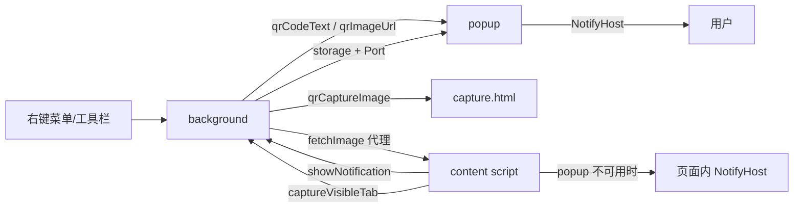

# AGENTS.md

给 AI Agent 的项目认知，用户可见说明见 [README.md](./README.md)。

**WXT + Vue 3 + TS** 跨浏览器二维码扩展（Chrome / Edge / Firefox）：生成二维码（当前页 / 选中文本），扫描二维码与一维条形码（网页图片 / 截图 / 本地图片 / 剪贴板），以及截图与框选重扫。

改完跑 `pnpm compile`（`vue-tsc --noEmit`，无测试）。命令、端口、manifest、目录结构、样式细节以 [package.json](./package.json)、[wxt.config.ts](./wxt.config.ts)、[.dev/](./.dev/) 和源码注释为准，本文只记读代码不易得到的约定与坑。

## 架构

- 入口：background（注册事件与右键菜单）、content（全站注入 UI）、popup、upload（`?camera=1` 摄像头）、capture（截视口扫描，`?frame=1` 框选）。后台能力拆在 `services/background/`，其余共用逻辑在 `services/`，UI 在 `components/`，流程在 `composables/`。
- 唯一入口不要分叉：扫描只走 `recognizeImage`，截图扫描只走 `useScreenshotScan`，扫描面板只有 `ScanPanel`，二维码 SVG 只由 `qrCode.ts` 生成。新增输入方式只实现一个“产出图像”的源。

## 降级链（内容脚本优先，逐级退到扩展页）

- 网页图片：内容脚本取图（动画 + 绿框）→ 注入不了就交 popup 取图 → 取图失败给「框选扫描」。
- 扫描屏幕：内容脚本截视口后走截图流程 → 不可用（独立 SVG、PDF 阅读器）时后台 `captureVisibleTab` 后开 `capture.html`。
- 框选：内容脚本浮层 → 扩展页经端口推回、在同一张截图上换可框选层 → 后台截视口开 `capture.html?frame=1`。
- 本地图片：内容脚本弹浮层 → 开 `upload.html`。摄像头始终开 `upload.html?camera=1`（popup 失焦即关，内容脚本受页面权限限制）。

## 通知

- 统一落 popup：`showPopupNotice` → 后台写 `qrNotification` 推送；没开窗则 `pageAction.openPopup` → `action.openPopup` → 页面内 `NotifyHost` 兜底。
- payload 必须可序列化：动作用 `PopupNoticeAction`（`open` / `copy` / `screenScan` / `frameScan` / `dismiss`），不要塞函数。不要为“收起通知”加消息：通知已结束就删记录，popup 无内容时自己关窗，靠下一条通知替换。
- `closeOriginTab` 让通知结束后关掉发起页（capture / upload）；点「框选扫描」时后台 `popupHost.keepTab()` 摘掉它，否则会关掉正要框选的那页。
- 竞态：`opening` / `POPUP_OPEN_GRACE` 防丢通知，自增 `id` 做 `clearIfCurrent`，`lastFinishedId` 防重复收尾。popup 断开连接时删 `qrNotification`，否则下次会重复弹出。

## 绿框与点选

- `bounds` 在原图坐标系。裁剪 / 缩放候选换算回来之后，**补高与夹紧一律按原图尺寸**；一维码条高由 `measureBarcodeBounds` 找条空剖面、`measureBarEdges` 取最外黑条（定位点在起始 / 终止图案中心）。
- 宿主只给 `anchor`（图像画在视口哪块矩形）并可给 `measureRect`：网页图片必须传，否则固定不滚动的图片上绿框会随滚动漂移。
- `deferResults` 暂缓结果通知，绿框自己叠：多码只弹一条“发现多个码”，点某个码才逐条出通知；点开过的只摘圆点、别删结果；点已看过的框或单码框 = 看完退出。空白点击在 `document` 捕获阶段判断，通知还开着时留到下一次点击。
- 内容相同的码有几份返回几份、各自圈出（解码层只合并“内容相同且包围盒重叠”的），通知列表按码型 + 内容去重并注明。
- 截图浮层：扫描屏幕 = 自动整屏框选一次，没扫到自动退回纯框选态（通知按钮只关通知）；单击（没拖出选区）或 Esc 退出；动画传 `mask: false`，免得与容器压暗叠成黑；浮层不跟通知走（`notificationResolved` 只清网页图片标记）。

## 扫描核心

- ZXing 用深路径导入（`@zxing/library/esm/core/...`），别改成包根导入。
- 摄像头逐帧只走 `decodeCameraFrame`；一维码命中必须过 `isOneDResultConfirmed` 核对相邻行（文字行也能凑出合法校验位）。
- 二维码整图与码面都失败时，把整图缩到 `QR_DOWNSCALE_DIMENSION` 再扫一遍（模块过大时定位点会漏检）。

## popup

- `main.ts` 必须在 `mount` 前先读 `qrNotification`：否则窗口先按二维码面板成型再收缩。
- 二维码热区里的 `.qr-panel-toggle` 只给键盘、`pointer-events: none`：否则右键命中的是按钮而不是 ``，`contexts: ['image']` 的「扫描图片」不会出现；在 popup 自己的码上右键走 `scanPopupQr` 彩蛋，用 `flashText` 而不是通知（尺寸不同会重排白闪）。
- 抽屉按钮要 `min-width: 0`，否则英文长文案撑破 220px 面板。
- 多码扫描：先弹“发现多个码”，关掉后留预览图叠绿点，点完最后一条由 `finishPickingIfDone` 收尾；点选期间靠 `picking` 让空窗兜底不关窗。

## 已知坑

- **跨域 / 防盗链**：`fetchViaProxy` 始终传，同源也可能 302 到 CDN 被 Chrome 判 canvas 污染，`loadImageDataFromUrl` 捕获污染错误后自动改走代理。
- **提示分两段**：取图慢于 150ms 才提示“正在获取图片”，超过 5s 换成建议扫描屏幕，图片之后到达仍继续扫。
- **大图解码阻塞 UI**：先等动画首帧，再 `setTimeout(50)` 后解码。
- **独立 SVG / XML 文档**：`createElement('div')` 没有 `.style`，integrated UI 会抛错；`content/index.ts` 开头的能力检查不能删，这类页面的扫描交 popup / `capture.html`。
- **扩展页收不到 `tabs.sendMessage`**：扩展页挂载时 `runtime.connect({ name: 'extensionPage' })`，后台用 `sendExtensionPageAction` 按标签页 id 推，别改回 `tabs.sendMessage`。
- **页面全局 CSS 会泄漏进注入 UI**：新增图标时在 `.qr-shot` / `.qr-notify-root` / `.qr-picker-icon` 上写全 `margin` 与 `opacity`。
- **`file://` 页面**：Firefox 扩展页 / 后台不能 fetch，内容脚本读已渲染图片画 canvas，失败回退截视口。
- **Chrome / Edge 的 popup 在 Linux 上打不了中文**：扩展弹窗拿不到输入法，改焦点 / composition 都无效，别加平台探测（需要时把扩展页当标签页打开）。

## 约定

- 注释、提交信息、用户可见文案用中文，标识符用英文；缩进 4 空格；新文件单引号 + 分号。
- 文案在 `public/_locales/en` 与 `zh_CN` 成对添加，代码里统一 `browser.i18n.getMessage`（各入口有本地 `t()`）。
- 不引入新依赖；不提交 `.env.submit` 与 `pnpm-lock.yaml`；不改 `.env` 里的本机路径。
- 平台差异用 `import.meta.env.FIREFOX`；`page_action` 只在 Firefox 声明；不要声明 `clipboardRead` / `clipboardWrite`。
- 临时数据用 `storageArea()`（session 回退 local），`takeStored*` 读后即清；`qr*` 键改动时全局搜索。
- 权限、manifest、图标只改 [wxt.config.ts](./wxt.config.ts)。

## 提交

- 每轮对话后有一定量改动、适合提交时，自行提交当前对话的改动。
- 检测到会话外的改动时，弹交互提示框让用户选择如何提交。
